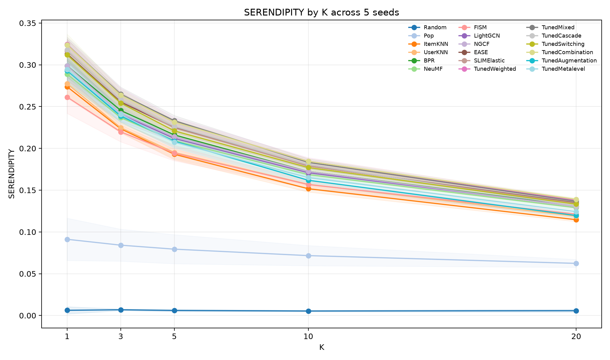

# Task 2.2 — Effectiveness Evaluation

## Experimental setting

Five repeated runs (seeds 2020–2024) use MovieLens 100K (943 users and 1,682 items), the nine tuned Task 1 individual models, Random and Pop baselines, and seven tuned hybrid designs. The individual configurations and selected hybrid hyperparameters are fixed from Task 1; learned hybrid parameters are refit on each run's validation data. Each run evaluates the same ranking protocol at K = 1, 3, 5, 10, and 20. Ranking relevance is binary test interaction after hiding train and validation interactions. Results below are seed means with two-sided 95% Student-t intervals across five seeds; MAE/MSE are reported once per run on finite test-pair predictions and do not depend on K.

## Experiments 1–2 — Individual and hybrid ranking quality

K=10 results (NDCG intervals shown; the other columns are seed means):

| Model | Type | NDCG@10 mean [95% CI] | Recall | Precision | MRR | Hit | MAP | F1 |
| --- | --- | ---: | ---: | ---: | ---: | ---: | ---: | ---: |
| Random | baseline | 0.0079 [0.0068, 0.0089] | 0.0058 | 0.0065 | 0.0197 | 0.0602 | 0.0029 | 0.0050 |
| Pop | baseline | 0.1095 [0.0881, 0.1309] | 0.0947 | 0.0856 | 0.2081 | 0.4899 | 0.0508 | 0.0729 |
| ItemKNN | individual | 0.2773 [0.2717, 0.2829] | 0.2358 | 0.1845 | 0.4632 | 0.7631 | 0.1680 | 0.1674 |
| UserKNN | individual | 0.2845 [0.2727, 0.2962] | 0.2453 | 0.1912 | 0.4718 | 0.7811 | 0.1707 | 0.1744 |
| BPR | individual | 0.3138 [0.3058, 0.3217] | 0.2672 | 0.2124 | 0.5065 | 0.8098 | 0.1935 | 0.1926 |
| NeuMF | individual | 0.3034 [0.2981, 0.3087] | 0.2588 | 0.2077 | 0.4917 | 0.7958 | 0.1858 | 0.1871 |
| FISM | individual | 0.2840 [0.2761, 0.2918] | 0.2485 | 0.1935 | 0.4677 | 0.7913 | 0.1676 | 0.1773 |
| LightGCN | individual | 0.3091 [0.3042, 0.3140] | 0.2614 | 0.2112 | 0.5005 | 0.8034 | 0.1902 | 0.1900 |
| NGCF | individual | 0.3118 [0.3050, 0.3186] | 0.2659 | 0.2126 | 0.5044 | 0.8083 | 0.1917 | 0.1918 |
| EASE | individual | 0.3266 [0.3198, 0.3335] | 0.2783 | 0.2201 | 0.5218 | 0.8165 | 0.2048 | 0.1998 |
| SLIMElastic | individual | 0.3289 [0.3206, 0.3371] | 0.2789 | 0.2201 | 0.5252 | 0.8176 | 0.2080 | 0.1998 |
| TunedWeighted | hybrid | 0.3380 [0.3304, 0.3455] | 0.2875 | 0.2276 | 0.5355 | 0.8303 | 0.2144 | 0.2066 |
| TunedCombination | hybrid | 0.3373 [0.3310, 0.3437] | 0.2861 | 0.2276 | 0.5351 | 0.8314 | 0.2140 | 0.2060 |
| TunedMixed | hybrid | 0.3343 [0.3267, 0.3419] | 0.2809 | 0.2251 | 0.5331 | 0.8199 | 0.2123 | 0.2030 |
| TunedCascade | hybrid | 0.3314 [0.3236, 0.3392] | 0.2816 | 0.2227 | 0.5277 | 0.8246 | 0.2092 | 0.2023 |
| TunedSwitching | hybrid | 0.3224 [0.3168, 0.3280] | 0.2721 | 0.2178 | 0.5188 | 0.8110 | 0.2021 | 0.1969 |
| TunedAugmentation | hybrid | 0.2971 [0.2877, 0.3066] | 0.2514 | 0.1976 | 0.4925 | 0.7892 | 0.1815 | 0.1797 |
| TunedMetalevel | hybrid | 0.3005 [0.2914, 0.3096] | 0.2509 | 0.2022 | 0.4927 | 0.7858 | 0.1859 | 0.1812 |

Weighted and Combination are the strongest hybrids at K=10. Paired seed-by-seed differences against the strongest individual, SLIMElastic, are +0.00909 NDCG for Weighted (95% CI [0.00531, 0.01288]) and +0.00848 for Combination ([0.00362, 0.01334]). Weighted leads hybrid Recall, MRR, MAP, and F1; Combination leads hybrid Hit@10. Weighted has the highest hybrid mean at K=1, 3, and 10; Mixed is highest at K=5 and Combination at K=20. Weighted and Combination are not separated from each other at K=10: paired difference +0.00062 [−0.00162, 0.00285]. These paired intervals use only five seed pairs.

## Experiment 3 — Difference from baselines

At K=10 every tuned hybrid exceeds Pop on mean NDCG. The strongest individual and top hybrids are:

| Model | NDCG@10 difference vs Pop [95% CI] |
| --- | ---: |
| SLIMElastic | +0.21936 [0.20452, 0.23419] |
| TunedWeighted | +0.22845 [0.21324, 0.24367] |
| TunedCombination | +0.22784 [0.21206, 0.24361] |
| TunedMixed | +0.22476 [0.20876, 0.24077] |
| TunedCascade | +0.22189 [0.20593, 0.23784] |

Random's near-zero NDCG makes relative percentage improvements misleading; absolute differences are the useful comparison. The separate Random coverage diagnostic is described below.

## Experiments 4–5 — Beyond-accuracy results and trade-offs

At K=10, the strongest non-baseline individual and hybrid for each dimension are:

| Metric | Strongest individual | Strongest hybrid |
| --- | --- | --- |
| Coverage | LightGCN 0.3740 | Combination 0.2881 |
| Novelty | LightGCN 8.7910 | Combination 8.5959 |
| ILD | SLIMElastic 0.8125 | Cascade 0.8083 |
| Serendipity | SLIMElastic 0.1791 | Weighted 0.1846 |

Combination has the broadest catalogue coverage among hybrids; Weighted and Combination have nearly identical serendipity. Across non-baseline models, K=10 Pearson correlations with NDCG are weak for coverage (r=0.121, 95% CI [0.017, 0.226]), novelty (r=0.052, [−0.052, 0.156]), and ILD (r=0.038, [−0.116, 0.192]). Serendipity is strongly correlated (r=0.991, [0.987, 0.995]), but it includes relevance and is not independent evidence of diversity. The four-dimensional Pareto analysis places Weighted and Combination on the frontier in all five runs; neither dominates every dimension.

**Random Coverage check.** Random mean Coverage@10 is 0.0372, versus about 99.6% expected if 943 users independently drew ten items uniformly from 1,682. That calculation assumes independent per-user draws. The saved Random export has only four distinct score rows for 943 users, so that assumption does not hold for this export. Coverage is the number of distinct top-10 items across evaluated users divided by catalogue size, after train/validation items are hidden. Interpret the 0.0372 as a property of the saved Random ranking/export, not independent per-user random sampling; the current results do not establish why the score rows repeat.

For explicit-rating prediction, NGCF has the lowest mean MAE (1.5510 [1.5093, 1.5926]) and MSE (3.8317 [3.6566, 4.0068]). These pointwise errors use finite test-pair predictions only, so hybrid values with different prediction coverage are not direct same-coverage comparisons.

