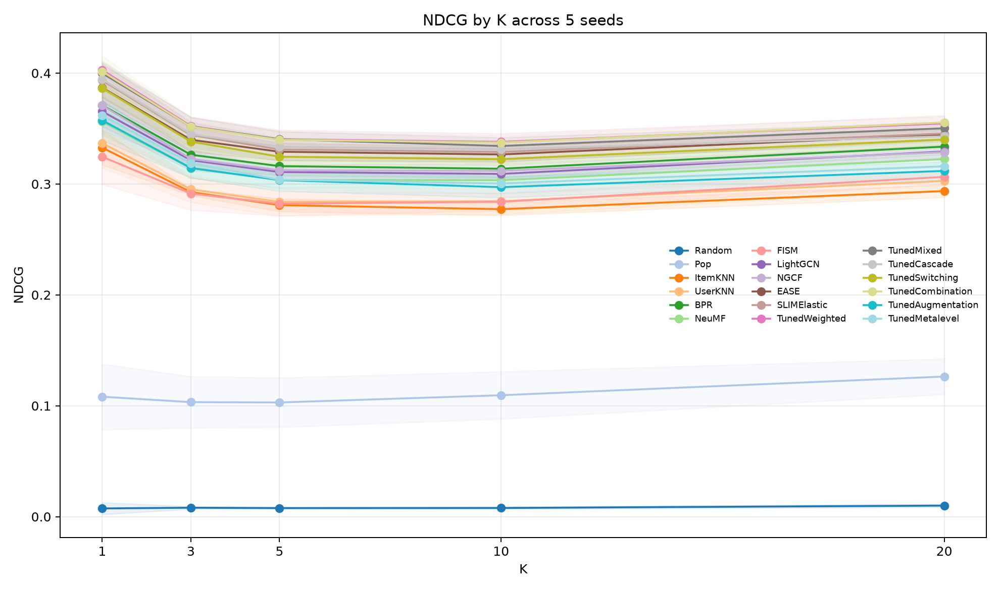

# Task 2.3 — Hybrid Contribution Analysis

## Experimental setting

Five runs (seeds 2020–2024) rebuild the Task 1 tuned member scores and refit learned hybrid parameters per run. Weighted contribution and ablation analyses use five validation-user folds and report NDCG@10. Means and 95% Student-t intervals below are across the five runs. The weighted-member pool contains ten members, including Pop and excluding Random; this is the configuration represented by the current results.

## Experiment 1 — Weighted coefficients and member ablations

The regularized logistic blend standardizes member scores per user. Coefficients are conditional on the included models and their correlated scores, so coefficient magnitude is not a causal contribution measure.

| Member | Mean coefficient [95% CI] | Absolute coefficient share |
| --- | ---: | ---: |
| EASE | 0.1139 [0.0430, 0.1847] | 22.37% |
| NeuMF | 0.1035 [0.0365, 0.1704] | 19.54% |
| SLIMElastic | 0.0887 [0.0354, 0.1419] | 18.19% |
| FISM | 0.0775 [0.0278, 0.1272] | 15.06% |
| Pop | 0.0342 [0.0106, 0.0578] | 6.21% |
| BPR | 0.0259 [0.0108, 0.0410] | 5.70% |
| NGCF | 0.0202 [0.0081, 0.0324] | 4.47% |
| ItemKNN | -0.0131 [-0.0253, -0.0009] | 3.61% |
| UserKNN | -0.0020 [-0.0100, 0.0060] | 3.52% |
| LightGCN | 0.0005 [-0.0042, 0.0051] | 1.34% |

The four largest coefficient shares (EASE, NeuMF, SLIMElastic, FISM) sum to about 75%. Member scores are correlated; for example, mean Pearson correlations are 0.951 for LightGCN–NGCF, 0.945 for BPR–LightGCN, and 0.912 for EASE–SLIMElastic. This overlap helps explain why a large fitted coefficient need not imply large marginal value.

| Removed member | Refit blend: full − ablated NDCG [95% CI] | Fixed weights: full − ablated NDCG [95% CI] |
| --- | ---: | ---: |
| SLIMElastic | +0.00496 [+0.00203, +0.00790] | +0.00402 [+0.00126, +0.00678] |
| FISM | +0.00213 [+0.00024, +0.00403] | +0.00211 [+0.00014, +0.00407] |
| NeuMF | +0.00150 [+0.00032, +0.00268] | +0.00181 [+0.00071, +0.00291] |
| BPR | +0.00059 [+0.00009, +0.00109] | +0.00076 [+0.00016, +0.00136] |
| NGCF | +0.00034 [-0.00039, +0.00106] | +0.00044 [-0.00035, +0.00123] |
| LightGCN | +0.00036 [-0.00003, +0.00076] | +0.00032 [-0.00017, +0.00082] |
| UserKNN | +0.00034 [-0.00074, +0.00142] | +0.00037 [-0.00067, +0.00142] |
| ItemKNN | +0.00022 [-0.00030, +0.00075] | +0.00030 [-0.00015, +0.00074] |
| Pop | +0.00037 [-0.00059, +0.00133] | -0.00012 [-0.00065, +0.00042] |
| EASE | -0.00027 [-0.00223, +0.00169] | -0.00056 [-0.00239, +0.00127] |

Positive values mean that retaining the member improves NDCG. Refit ablation removes a member and refits the remaining blend; fixed-weight ablation keeps the original fit and candidate pool while zeroing one member. Both identify SLIMElastic, FISM, and NeuMF as the clearest contributors; BPR has a smaller positive effect. Pop's interval includes zero in both analyses. EASE has a large coefficient share but no stable positive marginal effect.

The C sweep selected C=0.0001 (mean validation NDCG 0.2692 [0.2613, 0.2772]). Logistic regression uses C as the inverse regularization strength: smaller C is stronger regularization. Performance is slightly lower for C≤1e-5 and falls for C≥0.001, so the tested mean peaks at an intermediate C; intervals overlap.

| C | Mean validation NDCG@10 [95% CI] |
| ---: | ---: |
| 1e-7 | 0.2682 [0.2595, 0.2768] |
| 1e-6 | 0.2683 [0.2597, 0.2768] |
| 1e-5 | 0.2684 [0.2593, 0.2775] |
| 1e-4 | 0.2692 [0.2613, 0.2772] |
| 1e-3 | 0.2644 [0.2573, 0.2715] |
| 1e-2 | 0.2596 [0.2520, 0.2673] |
| 1e-1 | 0.2575 [0.2494, 0.2656] |
| 1 | 0.2570 [0.2486, 0.2654] |

This validation-fold NDCG is not directly comparable with Task 2.2's test NDCG: the evaluation stages and user subsets differ.

## Experiment 2 — Activity-conditioned contribution

Users are grouped by training interaction count, with group boundaries rebuilt per run. The global weighted model versus each group's best individual is:

| Activity group | Weighted NDCG@10 | Best individual NDCG@10 | Weighted − best [95% CI] |
| --- | ---: | ---: | ---: |
| 1 (16–27 interactions) | 0.2370 | 0.2419 | -0.00490 [-0.01129, +0.00150] |
| 2 (27–53) | 0.2391 | 0.2390 | +0.00014 [-0.00563, +0.00592] |
| 3 (53–120) | 0.2442 | 0.2380 | +0.00616 [+0.00078, +0.01153] |
| 4 (120–591) | 0.3570 | 0.3502 | +0.00678 [+0.00482, +0.00874] |

The weighted blend shows the clearest gains in groups 3–4; groups 1–2 have intervals including zero. The largest per-group leave-one-out effect is from SLIMElastic in every group: +0.00528 [-0.00335, +0.01391], +0.00516 [+0.00090, +0.00942], +0.00624 [+0.00126, +0.01122], and +0.00424 [+0.00130, +0.00719] for groups 1–4. EASE also contributes in group 1 (+0.00204 [+0.00033, +0.00374]); FISM contributes in group 3 (+0.00346 [+0.00188, +0.00504]). Refitting separate group-specific weights instead of the global weights changes NDCG by -0.00181, +0.00091, +0.00003, and +0.00044 across groups 1–4; every interval includes zero. Segment-level patterns therefore do not establish a better routing policy.

## Experiment 3 — Hybrid architecture diagnostics

**Mixed.** The full model averages validation NDCG@10 0.2675 [0.2603, 0.2746]. Removing FISM reduces it by +0.00126 [+0.00052, +0.00200]; the other member-removal intervals include zero. The equal-rank members do not make equal contributions.

**Switching.** Per-seed validation selection matches the best member within each activity group by design. Mean selected NDCG@10 is 0.2432, 0.2381, 0.2375, and 0.3496 for groups 1–4. The winning member varies across seeds and groups; this validation result does not by itself demonstrate a test-set gain from routing.

**Cascade.** On validation, the first-stage full ranking averages NDCG@10 0.2550 [0.2479, 0.2621]. A 20-item shortlist followed by second-stage ranking reaches 0.2650 [0.2577, 0.2723], versus 0.2638 [0.2561, 0.2716] for the second-stage model's full ranking.

**Feature Combination.** A fixed shallow-tree, five-fold feature diagnostic gives mean NDCG@10 0.2686 [0.2609, 0.2763] with member scores plus user and movie features, 0.2683 [0.2603, 0.2764] with member scores plus movie features, 0.2366 [0.2276, 0.2439] with member scores only, and 0.2366 [0.2294, 0.2438] with member scores plus user features. Movie features account for nearly all of the measured feature-block gain in this diagnostic; it does not establish how the separately tuned model uses each feature.

The plot is the Task 2.2 test-set K sweep and provides performance context; the coefficient, ablation, and architecture figures above are validation diagnostics.

