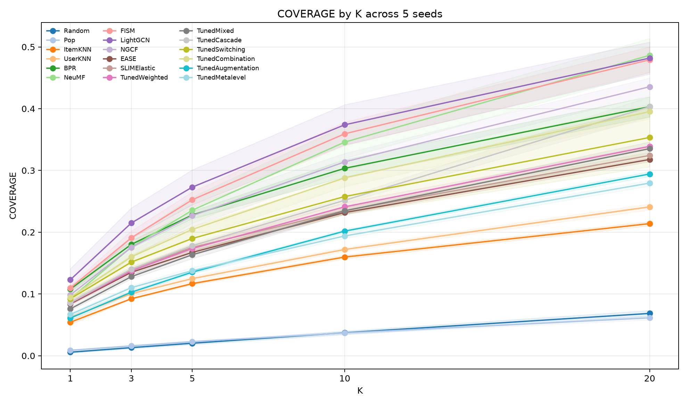
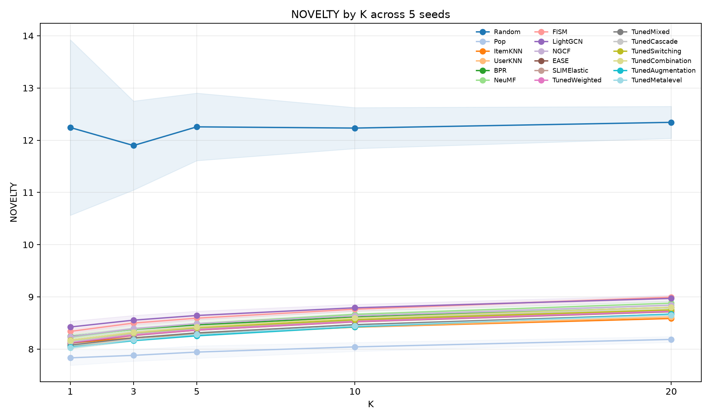

# Recommendation Systems — G12

Working notes behind the report. Every choice has its reason and every number is measured from `results/`.

## Experimental Setup

**Data.** MovieLens 100K with 943 users · 1,682 movies and 100,000 ratings. Every user has at least 20 ratings. The matrix is 93.7% empty and the top 10% of movies hold 42.7% of interactions.

**Protocol.** Any rating counts as one interaction. Each user's interactions are split at random into 80% train · 10% validation and 10% test. Models rank every movie the user has not seen and are scored on the top 10. Settings are chosen on validation and test is used only for reported numbers.

**Metrics.** NDCG@10 · Recall@10 · MRR@10 and Hit@10. Our own module in `source/metrics/` reproduces RecBole's values exactly for the nine tuned models.

**Framework.** RecBole from the course fork at commit `439c5a8` with its data and configurations unchanged. All models share one verified split and export a score for every user and movie so hybrids combine full rankings.

## Task 1 — Hybrid Recommender

Twelve models from six families: Random and Pop as baselines · ItemKNN and UserKNN as neighbourhood models · BPR · NeuMF and FISM as latent factor models · LightGCN and NGCF as graph models · EASE and SLIMElastic as linear item-item models · ContentBased on movie genres and release decade. ContentBased is evaluated on its own and stays out of the hybrids.

| Hypothesis | Source |
| --- | --- |
| Pop beats Random by a wide margin | Concentrated popularity |
| Linear item models are strong on ml-100k | Steck (2019) |
| A tuned BPR matches or beats NeuMF | Rendle et al. (2020) |
| LightGCN beats NGCF | He et al. (2020) |
| A weighted hybrid beats its best member | Different families make different errors (Burke 2002) |
| Different members win for different user groups | Short histories favour broad signals over item-item ones |

### 1.1 Individual Models

Each model trains once with its course configuration at seed 2020. ContentBased has no course configuration so its baseline is the textbook one: cosine between a movie's genres and the profile of the user's train movies (`parameters/ContentBased.yaml`).

| Model | NDCG@10 | Recall@10 | MRR@10 | Hit@10 |
| --- | --- | --- | --- | --- |
| Random | 0.0065 | 0.0056 | 0.0145 | 0.0636 |
| Pop | 0.1034 | 0.0880 | 0.1951 | 0.4698 |
| ItemKNN | 0.2834 | 0.2470 | 0.4623 | 0.7847 |
| UserKNN | 0.2873 | 0.2442 | 0.4834 | 0.7805 |
| BPR | 0.2494 | 0.2085 | 0.4304 | 0.7275 |
| NeuMF | 0.2678 | 0.2271 | 0.4530 | 0.7667 |
| FISM | 0.1409 | 0.1220 | 0.2669 | 0.5620 |
| LightGCN | 0.1586 | 0.1388 | 0.2963 | 0.6098 |
| NGCF | 0.1842 | 0.1545 | 0.3137 | 0.6394 |
| EASE | 0.3295 | 0.2805 | 0.5277 | 0.8197 |
| SLIMElastic | 0.3235 | 0.2750 | 0.5231 | 0.8123 |
| ContentBased | 0.0193 | 0.0153 | 0.0467 | 0.1241 |

**Observations.**
- **Content alone is weak.** ContentBased triples Random but reaches a fifth of Pop. Genres say what kind of movie a user likes but not which of the many movies of that kind they watched.
- **Linear item models lead.** EASE and SLIMElastic learn one weight per movie pair. With 1,682 movies and about 60 ratings each a full item-item model is cheap and well supported.
- **Neighbourhood models follow.** ItemKNN and UserKNN use the same co-occurrence signal with fixed cosine weights instead of learned ones.
- **Pop reaches 16 times Random.** Concentrated popularity lets one ranking for everyone find many test movies.
- **Trained models are cut short.** All five stop at the 20 epoch limit (`epochs` in `results/metrics/*.json`) so the course settings rank them by training budget rather than capacity.

### 1.2 Tuning

**Method.**
- **Selection.** Validation NDCG@10 since it credits every hit by rank while MRR credits only the first.
- **Budget.** Up to 500 epochs with validation every 5 and a stop after 6 checks without gain. Every trial records its epochs to show no winner hit the cap.
- **Search.** Full grids for models with one or two settings and for ContentBased whose 108 points score in seconds. Seeded TPE with 40 to 70 trials for four to eight settings since random search beats grids at equal budget (Bergstra and Bengio 2012) and TPE learns from earlier trials.
- **Spaces.** Set wide in one pass from each paper and RecBole's defaults (Appendix B). A winner on an edge is a limitation.
- **Parallelism.** A free worker starts the next trial at once. Grids are identical at any worker count and one worker reproduces RecBole's sequential TPE. FISM was tuned with 5 workers on an RTX 4090 since its scoring takes hours per trial on CPU. All final runs used that GPU.
- **Robustness.** Each winner is retrained with seeds 2020 to 2024 which redraw split and initialisation. A gap smaller than the spread is a tie.

| Model | Method | Trials | Valid NDCG@10 | Winner Epochs | Capped Trials |
| --- | --- | --- | --- | --- | --- |
| EASE | Grid | 17 | 0.2581 | — | — |
| ItemKNN | Grid | 50 | 0.2234 | — | — |
| UserKNN | Grid | 45 | 0.2355 | — | — |
| SLIMElastic | Grid | 56 | 0.2589 | — | — |
| ContentBased | Grid | 108 | 0.0554 | — | — |
| BPR | TPE | 60 | 0.2535 | 220 | 8 |
| NeuMF | TPE | 70 | 0.2501 | 170 | 2 |
| LightGCN | TPE | 50 | 0.2504 | 270 | 5 |
| NGCF | TPE | 40 | 0.2523 | 220 | 7 |
| FISM | TPE | 40 | 0.2406 | 125 | 3 |

| Model | Course NDCG@10 | Tuned NDCG@10 | Tuned Recall@10 | 5 Seeds NDCG@10 |
| --- | --- | --- | --- | --- |
| Random | 0.0065 | 0.0065 | 0.0056 | 0.0072 ± 0.0013 |
| Pop | 0.1034 | 0.1032 | 0.0850 | 0.1097 ± 0.0187 |
| ItemKNN | 0.2834 | 0.2783 | 0.2370 | 0.2773 ± 0.0045 |
| UserKNN | 0.2873 | 0.2877 | 0.2524 | 0.2844 ± 0.0095 |
| BPR | 0.2494 | 0.3197 | 0.2683 | 0.3138 ± 0.0064 |
| NeuMF | 0.2678 | 0.3116 | 0.2637 | 0.3043 ± 0.0056 |
| FISM | 0.1409 | 0.2875 | 0.2489 | 0.2840 ± 0.0064 |
| LightGCN | 0.1586 | 0.3146 | 0.2661 | 0.3091 ± 0.0039 |
| NGCF | 0.1842 | 0.3201 | 0.2745 | 0.3112 ± 0.0058 |
| EASE | 0.3295 | 0.3309 | 0.2808 | 0.3266 ± 0.0055 |
| SLIMElastic | 0.3235 | 0.3240 | 0.2769 | 0.3288 ± 0.0066 |
| ContentBased | 0.0193 | 0.0457 | 0.0343 | — |

ContentBased wins with the neighbourhood method over the `k` 400 most similar movies · decade weight 1.0 and idf weighting (`parameters/tuned/ContentBased.yaml`).

**Observations.**
- **Neighbours beat one profile for content.** The best profile setting reaches 0.0369 on validation against 0.0554 for neighbours. With every neighbour kept the two methods rank identically up to float ties so the gain comes from `k` alone. A user's taste is several clusters of genres which one averaged profile blurs.
- **Release decade and rare genres help.** The best setting without the decade reaches 0.0470 on validation. The decade and idf weighting lift ContentBased to 2.4 times its baseline on test yet it stays below Pop.
- **Budget was the bottleneck.** Trained winners stop between 125 and 270 epochs against the course limit of 20. LightGCN and FISM double their NDCG@10.
- **Grid models were near their best.** EASE peaks at `reg_weight` 300 beside the course value of 250 and the five best ItemKNN settings lie within 0.001. ItemKNN's 0.005 test drop is selection noise on that plateau.
- **Full rank item models still lead.** FISM learns item similarity through low rank factors and takes the largest embedding on offer so this catalogue needs the high rank a full weight matrix gives for free.
- **Extra capacity does not pay.** NeuMF takes the smallest embeddings on offer and still trails BPR which matches Rendle et al. (2020).
- **Graph simplification does not matter here.** NGCF ties LightGCN once dropout and regularisation hold its extra weights in check. LightGCN's gain was shown on larger sparser data (He et al. 2020).

*Figure: validation NDCG@10 against epochs for every TPE trial from `results/tuning/{BPR,NeuMF,LightGCN,NGCF,FISM}.csv` · shows every top trial running far past 20 epochs.*

*Figure: validation NDCG@10 against `reg_weight` from `results/tuning/EASE.csv` · shows the flat optimum around the course value.*

| Hypothesis | Verdict |
| --- | --- |
| Pop beats Random by a wide margin | Holds with 0.110 against 0.007 |
| Linear item models are strong on ml-100k | Holds as SLIMElastic and EASE lead and tie |
| A tuned BPR matches or beats NeuMF | Holds with 0.314 against 0.304 beyond either spread |
| LightGCN beats NGCF | Not supported as they tie |

**Limitations.**
- Winners on an edge: BPR and LightGCN at the largest batch · LightGCN · NGCF and FISM at the largest embedding · NGCF at the largest node dropout · NeuMF at the smallest embeddings.
- Some low learning rate trials hit the 500 epoch cap but none won.
- Eight models were tuned on CPU and FISM on GPU which can shift close winners but not the reported test numbers.
- SLIMElastic ties at `l1_ratio` 0.001 and 0.0001 and the earlier trial wins.
- NGCF differs in the fourth decimal between identical runs while every other model repeats exactly.
- ContentBased's 1,682 movies share only 216 genre combinations so many scores tie and float rounding breaks them. Its fourth decimal shifts between machines and the best two settings lie within 0.0003.
- ContentBased's first grid had its winner on the largest decade weight and `k` so both were widened once. It runs outside RecBole so it has no 5 seed spread.

### 1.3 Weighted Hybrid

**Method.**
- **Score.** A weighted sum of the members' scores for a user and movie with weights learned by regression on validation.
- **Members.** The nine tuned models and Pop. Random carries no signal and ContentBased was added after the hybrids were run.
- **Scaling.** Each member is standardised per user over the movies outside train since raw scales differ and only the order within a user matters.
- **Candidates.** The union of every member's top 100 movies per user as in the ranking stage of industrial recommenders. The fit then learns the order near the top which is all NDCG@10 sees. They cover 79% of validation movies in about 215,000 rows.
- **Regression.** Logistic regression with L2 on a 0 or 1 label for validation movies. Each weight reads as a member's effect on the odds of a hit and L2 keeps near-duplicate members stable.
- **Strength.** Five-fold cross-validation over users picks C and the spread across folds measures weight stability. Final weights use all users and test is scored once.

Fitting on every movie outside train lost to SLIMElastic even on validation (0.2509 against 0.2589) since the fit spent its effort on obvious misses in the tail. On candidates weak regularisation lets correlated members cancel out (LightGCN −0.90 against NGCF 0.55) while strong regularisation pulls the weights toward a balanced mix.

| C | Cross-Validated NDCG@10 |
| --- | --- |
| 1 | 0.2508 |
| 0.01 | 0.2521 |
| 0.001 | 0.2571 |
| 0.0001 | 0.2642 |
| 0.00001 | 0.2631 |
| 0.0000001 | 0.2630 |

*Figure: cross-validated NDCG@10 against C from `cv` in `results/hybrid/metrics/Weighted.json` with SLIMElastic's 0.2589 as a line · shows ranking rising as weights shrink toward a balanced mix.*

| Model | Test NDCG@10 | Test Recall@10 |
| --- | --- | --- |
| Weighted Hybrid | 0.3378 | 0.2879 |
| EASE | 0.3309 | 0.2808 |
| SLIMElastic | 0.3240 | 0.2769 |

| Member | Weight | Spread Across Folds |
| --- | --- | --- |
| EASE | 0.139 | 0.002 |
| NeuMF | 0.138 | 0.003 |
| SLIMElastic | 0.111 | 0.003 |
| FISM | 0.079 | 0.003 |
| Pop | 0.035 | 0.004 |
| BPR | 0.030 | 0.002 |
| NGCF | 0.029 | 0.002 |
| LightGCN | 0.003 | 0.001 |
| UserKNN | −0.006 | 0.002 |
| ItemKNN | −0.017 | 0.002 |

**Observations.**
- **The hybrid wins narrowly.** It gains 0.007 over EASE which is about one seed spread so the hypothesis holds but only just.
- **Weight goes to members that err differently.** Full item-item weights (EASE and SLIMElastic) · a non-linear MLP (NeuMF) and low rank item similarity (FISM) view the data differently so their mistakes overlap less.
- **Embedding models share one slot.** BPR · NGCF and LightGCN all score by an embedding dot product so once one is in the others add little.
- **Neighbourhood models only correct.** ItemKNN and UserKNN repeat the co-occurrence signal that EASE and SLIMElastic learn better.
- **Shrinkage beats a free fit.** The pointwise loss rewards separating hits from misses rather than ordering the top which matches the blending literature.
- **Weights are stable.** No weight moves more than 0.004 across folds so 2.3 can read them directly.

*Figure: correlation between members' scores on candidates from `results/tuned/scores/*.npz` with train movies hidden via `results/split/train.tsv` · expected to show the embedding and item-item models as two blocks.*

**Limitations.**
- Members were tuned on the same validation set which can only lower the test score. Full stacking would cost hours of retraining for a small effect.
- Only the seed 2020 split has score tables.
- 21% of validation movies fall outside the candidates and can never be ranked. The depth of 100 is a setting for 1.5.

### 1.4 Other Hybrids

The remaining six designs of Burke (2002) on the tuned members and the 1.3 protocol. The first three combine finished score tables. The last three reach inside a model or bring in genres and demographics that no member has seen.

**Method.**
- **Switching.** Users fall into three equal groups by train size. Each group uses the member with the best validation NDCG@10 in that group so it tests whether families win for different users.
- **Mixed.** Every member's ranking is fused by reciprocal rank fusion with k = 60 (Cormack et al. 2009). It learns nothing so it shows what the 1.3 weights add.
- **Cascade.** EASE proposes its top 50 and NeuMF reorders them. The two carry the largest 1.3 weights and come from different families.
- **Feature Combination.** A gradient-boosted classifier on the 1.3 candidates over the 10 member scores plus each movie's genres year and popularity and each user's age gender occupation and activity. It tests whether a learner can find where each member is right.
- **Feature Augmentation.** EASE's top 10 unseen movies per user join train as pseudo-interactions and UserKNN is refit on the denser matrix. It tests whether the strongest model can fix the sparse overlap that user neighbourhoods depend on.
- **Meta-Level.** UserKNN takes its neighbours from the cosine of LightGCN's learned user embeddings instead of raw co-ratings. It tests whether graph propagation finds better peers than direct overlap.

**Proof.** Combination with a linear learner and no side features reproduces Weighted exactly at cross-validated 0.2642 and test 0.3378. The shared neighbourhood on raw ratings reproduces tuned UserKNN for all 943 users once RecBole's padding row is kept since it decides ties at the 50th peer. The saved LightGCN embeddings reproduce its score table to 1e-5.

| Model | Test NDCG@10 | Test Recall@10 |
| --- | --- | --- |
| Weighted (1.3) | 0.3378 | 0.2879 |
| Mixed | 0.3316 | 0.2776 |
| EASE | 0.3309 | 0.2808 |
| Feature Combination | 0.3305 | 0.2852 |
| Switching | 0.3239 | 0.2726 |
| Cascade | 0.3142 | 0.2656 |
| Meta-Level | 0.3023 | 0.2563 |
| Feature Augmentation | 0.2981 | 0.2540 |
| UserKNN | 0.2877 | 0.2524 |

| Train Movies | Switching Member |
| --- | --- |
| 16 to 34 | LightGCN |
| 34 to 92 | SLIMElastic |
| 93 to 591 | EASE |

**Observations.**
- **Short histories go to the graph model.** LightGCN wins for the lightest users since propagation borrows signal from similar users when a user's own history is thin. Item-item models win once histories are long enough to match movie to movie so the hypothesis holds.
- **Switching still trails EASE.** Each group picks from about 314 users and its validation lead of 0.2614 against 0.2581 turns into 0.3239 against 0.3309 on test.
- **Equal votes tie the best member.** Fusion counts weak members such as Pop and the neighbourhood models as much as strong ones. The 1.3 weights add about 0.006 on top by muting them.
- **The last stage sets the order.** The cascade shortlist holds half of all test movies but NeuMF orders it worse than EASE does so the result lands beside NeuMF alone.
- **Side data is already inside the members.** Genres and demographics lift a linear learner by only 0.001 in cross-validation from 0.2642 to 0.2654. The default booster reaches 0.3508 in-sample but 0.2520 in cross-validation so its non-linearity overfits more than the side data gives.
- **Densifying helps the users who need it least.** Augmentation lifts UserKNN by 0.010 but its lightest third falls from 0.2450 to 0.2356 while the middle and heaviest thirds gain 0.015 and 0.025. Ten pseudo-interactions are up to 38% of a light user's profile. The hypothesis fails.
- **Learned peers beat co-rated peers but not their source.** Meta-Level lifts UserKNN by 0.015 with the heaviest third gaining 0.037 and the lightest none. It still trails LightGCN at 0.3146 so the embeddings rank better directly than as a similarity.
- **Only linear weights clearly win.** Choosing one member per user or per stage throws away the others while weighting keeps every signal in proportion.

*Figure: validation NDCG@10 of every member per train size group from `results/tuned/scores/*.npz` with `results/split/{train,valid}.tsv` · shows the winner shifting from LightGCN to the item-item models.*

**Limitations.**
- Groups and stages and the booster and the pseudo count are fixed by hand as settings for 1.5.

### 1.5 Hybrid Tuning

Every setting is chosen on validation and each tuned hybrid is scored on test once. Hybrids that learn from validation are tuned by the same five-fold user cross-validation as 1.3 so no user scores a choice it helped make.

**Method.**
- **Weighted.** Candidate depth 25 · 50 · 100 · 200 jointly with the eight L2 strengths by cross-validation.
- **Switching.** 1 to 5 train size groups by cross-validation where 1 group is the best single member.
- **Mixed.** Fusion constant 1 · 10 · 30 · 60 · 100 · 300 over the best 2 · 3 · 5 or all 10 members by their own validation NDCG@10 on plain validation.
- **Cascade.** Every ordered pair of members with shortlists of 20 · 50 · 100 · 200 on plain validation.
- **Feature Combination.** Tree depth 2 · 3 · 4 or unlimited with learning rates 0.03 · 0.1 · 0.3 by cross-validation.
- **Feature Augmentation.** Pseudo-interactions 0 · 5 · 10 · 20 · 50 per user with 25 · 50 · 100 · 200 peers on plain validation.
- **Meta-Level.** LightGCN or NGCF embeddings with 25 · 50 · 100 · 200 peers on plain validation.

**Proof.** Each 1.3 and 1.4 default sits inside its grid and must reproduce its recorded numbers before any tuned number is trusted.

**Weighted.** At depth 100 the cross-validation reproduces the 1.3 scores exactly. Tuning keeps the default of depth 100 at C = 0.0001 so test stays at 0.3378. Depth 25 to 200 moves the best cross-validated score by under 0.001 while C moves it by 0.011 to 0.022 so the shrinkage matters and the candidate count does not.

**Switching.** Four groups win cross-validation and pick LightGCN for users with 16 to 27 train movies and SLIMElastic above. Test falls to 0.3209 against 0.3239 for the default of three. One to five groups score 0.2545 and 0.2505 and 0.2499 and 0.2572 and 0.2565 in cross-validation. Four groups beat three on all five folds by 0.007 but beat one group on only three folds by 0.003 so switching gains nothing reliable over the best single member once the choice is made on held-out users.

**Mixed.** At k = 60 with all 10 members the test scores reproduce 1.4 exactly. All 10 members win at k = 10 and test rises to 0.3388 against 0.3316 for the default.

| Members | Best k | Validation NDCG@10 |
| --- | --- | --- |
| 2 | 1 | 0.2620 |
| 3 | 1 | 0.2634 |
| 5 | 1 | 0.2657 |
| 10 | 10 | 0.2671 |

A small k lets the top ranks dominate so weak members barely vote. This mutes them as the 1.3 weights do and matches Weighted within 0.001 without learning. The choice is made on plain validation and k = 1 trails k = 10 by only 0.0004.

**Cascade.** EASE to NeuMF at 50 reproduces the 1.4 test scores exactly and sits at 0.2487 on validation. Of 360 settings BPR shortlisting 20 for SLIMElastic wins and test rises to 0.3282 against 0.3142 for the default.

| Stages | Shortlist | Validation NDCG@10 |
| --- | --- | --- |
| BPR → SLIMElastic | 20 | 0.2624 |
| LightGCN → SLIMElastic | 20 | 0.2622 |
| LightGCN → SLIMElastic | 50 | 0.2599 |
| SLIMElastic alone | — | 0.2589 |
| EASE → NeuMF | 50 | 0.2487 |

The strongest member belongs second where it orders a short list that a different model family proposes. The default wasted EASE on shortlisting and let the weaker NeuMF decide. The winner beats SLIMElastic alone by 0.0035 on validation but was picked from 360 settings so part of that gain is selection luck. On test it still trails EASE alone at 0.3309.

**Feature Combination.** Unlimited depth at rate 0.1 reproduces the 1.4 cross-validation of 0.2520. Depth 2 wins at 0.2635 and test rises to 0.3373 against 0.3305. It stops at the 100 round cap but lifting the cap to 1000 only moves it to 0.2628. The best booster is the shallowest and still trails linear Weighted at 0.2642.

**Feature Augmentation.** No pseudo-interactions at 50 peers reproduces UserKNN at 0.2355 on validation. Five pseudo-interactions with 25 peers win at 0.2426 and test rises to 0.3027 against 0.2981.

| Peers | 0 Pseudo | 5 Pseudo | 10 Pseudo | 50 Pseudo |
| --- | --- | --- | --- | --- |
| 25 | 0.2259 | 0.2426 | 0.2403 | 0.1969 |
| 50 | 0.2355 | 0.2397 | 0.2379 | 0.2066 |
| 200 | 0.2241 | 0.2238 | 0.2229 | 0.2099 |

Pseudo-interactions gain 0.017 with 25 peers and nothing with 200 so densifying pays only while neighbourhoods are narrow.

**Meta-Level.** LightGCN at 50 peers reproduces 1.4. NGCF embeddings at 50 peers win at 0.2512 against 0.2477 and test moves to 0.3030 against 0.3023.

**Results.** Test scores of each default against its tuned setting in `results/hybrid/metrics/Tuned*.json`.

| Hybrid | Default NDCG@10 | Tuned NDCG@10 | Tuned Recall@10 | Tuned Setting |
| --- | --- | --- | --- | --- |
| Mixed | 0.3316 | 0.3388 | 0.2844 | All 10 Members at k = 10 |
| Weighted | 0.3378 | 0.3378 | 0.2879 | Depth 100 at C = 0.0001 |
| Feature Combination | 0.3305 | 0.3373 | 0.2902 | Depth 2 at Rate 0.1 |
| Cascade | 0.3142 | 0.3282 | 0.2831 | BPR → SLIMElastic at 20 |
| Switching | 0.3239 | 0.3209 | 0.2728 | 4 Groups |
| Meta-Level | 0.3023 | 0.3030 | 0.2590 | NGCF at 50 Peers |
| Feature Augmentation | 0.2981 | 0.3027 | 0.2562 | 5 Pseudo at 25 Peers |
| EASE | — | 0.3309 | 0.2808 | Best Single Model |

**Observations.**
- **Tuning mostly fixes bad defaults.** Cascade gains 0.014 once the order of its stages flips while Weighted was already at its optimum.
- **Muting weak members is what pays.** A small fusion constant and strong L2 shrinkage both let the best members decide and land within 0.001 of each other.
- **Non-linearity pays only when held down.** The booster gains 0.007 once its trees are cut to depth 2 and then lands within 0.0005 of Weighted.

*Figure: validation NDCG@10 over the mixed grid from `results/hybrid/metrics/TunedMixed.json` · shows the gain from small k and more members.*

**Limitations.**
- Mixed and Cascade and Augmentation and Meta-Level settings are chosen on plain validation so their test gains may include selection luck.
- Tuned Mixed and Combination sit within one seed spread of Weighted so none of the three is reliably best.

## Task 2 — Evaluation of Effectiveness

### Experimental design

**Objectives.** Task 2 tests whether combining recommenders improves ranking quality, which members and side features contribute to that performance, and whether candidate retrieval or final ranking limits recommendations of long-tail movies. We compare Random and Pop, nine tuned individual models and seven tuned hybrid architectures: Weighted, Combination, Mixed, Cascade, Switching, Augmentation and Metalevel.

**Data and repetitions.** MovieLens 100K contains 943 users and 1,682 movies. Seeds 2020–2024 each define a distinct split and model-training run. Each split contains 80,808 training, 9,596 validation and 9,596 test interactions, with disjoint partitions. All models within a seed share the same split and aligned user/item IDs. Any observed rating is treated as binary relevance. Training interactions fit the individual models; validation selects settings and fits the hybrids. Task 2 evaluates the resulting 55 individual/baseline and 35 final hybrid score tables on CPU; fitting the contribution ablations is separate from training the final models.

**Ranking and metrics.** Test rankings hide training and validation interactions and are evaluated at K=1,3,5,10,20 for users with test interactions (all 943 users in these splits). The seven ranking measures are NDCG, Recall, Precision, MRR, Hit, MAP and per-user F1. Catalogue coverage measures the fraction of movies recommended at least once; novelty is mean popularity self-information; intra-list diversity (ILD) is mean pairwise genre Jaccard distance; serendipity weights relevant recommendations by genre distance from the user's history. MAE, MSE and RMSE are outside this implicit-ranking task because the scores are not calibrated 1–5 rating predictions.

**Uncertainty.** Seed means use two-sided 95% Student-t intervals (four degrees of freedom); model differences are paired within seed. A complementary bootstrap conditions on seed 2020 and uses 10,000 shared user resamples across models and K. It estimates intervals for additive user-level metrics and paired differences. Catalogue coverage uses seed-level intervals only, because resampling users changes the unique-item union. These two procedures describe different sources of uncertainty.

| Study | Design | Evaluation scope |
| --- | --- | --- |
| 2.2: Experiments 1–2 | Evaluate 11 individual/baseline and seven hybrid models with 11 metrics at five K values | Test; matched splits within seed |
| 2.2: Experiment 3 | Compare models with Random and Pop using paired differences | Test; seed-level contrasts |
| 2.2: Experiments 4–5 | Compare beyond-accuracy ranks, metric correlations and Pareto frontiers; bootstrap user-level differences | Test; seed means and conditional user bootstrap |
| 2.3: Contributions | Inspect selected Weighted coefficients, regularization, member removal, activity groups and Combination feature blocks | Five-fold validation-user CV for Weighted/Combination; validation diagnostics for Mixed/Switching/Cascade |
| 2.4: Behaviour and long tail | Compare user routing, 8 × 6 × 5 candidate pipelines, popularity exposure and five tail-retrieval strategies | Test; exploratory pipeline sweep and descriptive oracle |

**Experiment records.** [Complete results](../results/task2/reanalysis_cpu/aggregate/), [protocol and provenance](../results/task2/reanalysis_cpu/reanalysis_protocol.json), [data and aggregation checks](../results/task2/reanalysis_cpu/report_audit.json), [all seed-level metrics](../results/task2/reanalysis_cpu/aggregate/per_seed_metrics.csv) and [all metric means, SDs and intervals](../results/task2/reanalysis_cpu/aggregate/metric_summary.csv) accompany the tables below. Source snapshots and output hashes preserve the executed experiment. Commands are in the [README command table](../README.md#simulate).

### Experimental results

#### Task 2.2 — Effectiveness evaluation

##### Experiments 1–2: ranking quality

The table reports all 18 models at K=10. NDCG includes its across-seed interval; the other ranking columns show seed means. Full results at every K and intervals for every metric are linked above.

| Model | Type | NDCG@10 [95% CI] | Recall | Precision | MRR | Hit | MAP | F1 |
| --- | --- | --- | --- | --- | --- | --- | --- | --- |
| Random | baseline | 0.0079 [0.0068, 0.0089] | 0.0058 | 0.0065 | 0.0197 | 0.0602 | 0.0029 | 0.0050 |
| Pop | baseline | 0.1095 [0.0881, 0.1309] | 0.0947 | 0.0856 | 0.2081 | 0.4899 | 0.0508 | 0.0729 |
| ItemKNN | individual | 0.2773 [0.2717, 0.2829] | 0.2358 | 0.1845 | 0.4632 | 0.7631 | 0.1680 | 0.1674 |
| UserKNN | individual | 0.2845 [0.2727, 0.2962] | 0.2453 | 0.1912 | 0.4718 | 0.7811 | 0.1707 | 0.1744 |
| BPR | individual | 0.3138 [0.3058, 0.3217] | 0.2672 | 0.2124 | 0.5065 | 0.8098 | 0.1935 | 0.1926 |
| NeuMF | individual | 0.3034 [0.2981, 0.3087] | 0.2588 | 0.2077 | 0.4917 | 0.7958 | 0.1858 | 0.1871 |
| FISM | individual | 0.2840 [0.2761, 0.2918] | 0.2485 | 0.1935 | 0.4677 | 0.7913 | 0.1676 | 0.1773 |
| LightGCN | individual | 0.3091 [0.3042, 0.3140] | 0.2614 | 0.2112 | 0.5005 | 0.8034 | 0.1902 | 0.1900 |
| NGCF | individual | 0.3118 [0.3050, 0.3186] | 0.2659 | 0.2126 | 0.5044 | 0.8083 | 0.1917 | 0.1918 |
| EASE | individual | 0.3266 [0.3198, 0.3335] | 0.2783 | 0.2201 | 0.5218 | 0.8165 | 0.2048 | 0.1998 |
| SLIMElastic | individual | 0.3289 [0.3206, 0.3371] | 0.2789 | 0.2201 | 0.5252 | 0.8176 | 0.2080 | 0.1998 |
| TunedWeighted | hybrid | 0.3380 [0.3304, 0.3455] | 0.2875 | 0.2276 | 0.5355 | 0.8303 | 0.2144 | 0.2066 |
| TunedCombination | hybrid | 0.3373 [0.3310, 0.3437] | 0.2861 | 0.2276 | 0.5351 | 0.8314 | 0.2140 | 0.2060 |
| TunedMixed | hybrid | 0.3343 [0.3267, 0.3419] | 0.2809 | 0.2251 | 0.5331 | 0.8199 | 0.2123 | 0.2030 |
| TunedCascade | hybrid | 0.3314 [0.3236, 0.3392] | 0.2816 | 0.2227 | 0.5277 | 0.8246 | 0.2092 | 0.2023 |
| TunedSwitching | hybrid | 0.3224 [0.3168, 0.3280] | 0.2721 | 0.2178 | 0.5188 | 0.8110 | 0.2021 | 0.1969 |
| TunedAugmentation | hybrid | 0.2971 [0.2877, 0.3066] | 0.2514 | 0.1976 | 0.4925 | 0.7892 | 0.1815 | 0.1797 |
| TunedMetalevel | hybrid | 0.3005 [0.2914, 0.3096] | 0.2509 | 0.2022 | 0.4927 | 0.7858 | 0.1859 | 0.1812 |

Weighted and Combination have the highest mean NDCG among the hybrids. Their paired NDCG gains over SLIMElastic are +0.00909 [+0.00531, +0.01288] and +0.00848 [+0.00362, +0.01334]. Weighted minus Combination is +0.00062 [-0.00162, +0.00285]; this interval includes zero.

##### Experiment 3: baseline contrasts

| Model | NDCG@10 minus Random [95% CI] | NDCG@10 minus Pop [95% CI] |
| --- | --- | --- |
| ItemKNN | +0.26943 [+0.26338, +0.27549] | +0.16779 [+0.15117, +0.18440] |
| UserKNN | +0.27660 [+0.26448, +0.28873] | +0.17496 [+0.16049, +0.18942] |
| BPR | +0.30590 [+0.29712, +0.31468] | +0.20425 [+0.18563, +0.22288] |
| NeuMF | +0.29553 [+0.28966, +0.30140] | +0.19388 [+0.17348, +0.21428] |
| FISM | +0.27611 [+0.26761, +0.28461] | +0.17446 [+0.15582, +0.19311] |
| LightGCN | +0.30124 [+0.29540, +0.30708] | +0.19959 [+0.17916, +0.22002] |
| NGCF | +0.30394 [+0.29622, +0.31165] | +0.20229 [+0.17845, +0.22612] |
| EASE | +0.31877 [+0.31126, +0.32629] | +0.21712 [+0.19997, +0.23428] |
| SLIMElastic | +0.32101 [+0.31270, +0.32931] | +0.21936 [+0.20452, +0.23419] |
| TunedWeighted | +0.33010 [+0.32211, +0.33809] | +0.22845 [+0.21324, +0.24367] |
| TunedCombination | +0.32948 [+0.32275, +0.33622] | +0.22784 [+0.21206, +0.24361] |
| TunedMixed | +0.32641 [+0.31822, +0.33460] | +0.22476 [+0.20876, +0.24077] |
| TunedCascade | +0.32354 [+0.31553, +0.33155] | +0.22189 [+0.20593, +0.23784] |
| TunedSwitching | +0.31454 [+0.30915, +0.31992] | +0.21289 [+0.19552, +0.23026] |
| TunedAugmentation | +0.28926 [+0.27904, +0.29949] | +0.18762 [+0.16995, +0.20528] |
| TunedMetalevel | +0.29264 [+0.28287, +0.30240] | +0.19099 [+0.17495, +0.20703] |

Every trained individual model and hybrid outperforms both baselines on NDCG@10, with positive paired intervals. Absolute differences express the size of the gain directly; percentage changes over near-zero Random scores would exaggerate its apparent size.

##### Experiments 4–5: beyond-accuracy and uncertainty

| Model | Coverage@10 [95% CI] | Novelty@10 | ILD@10 | Serendipity@10 |
| --- | --- | --- | --- | --- |
| Random | 0.0372 [0.0343, 0.0401] | 12.2325 | 0.7914 | 0.0054 |
| Pop | 0.0369 [0.0351, 0.0387] | 8.0422 | 0.8297 | 0.0717 |
| ItemKNN | 0.1598 [0.1569, 0.1627] | 8.4207 | 0.8139 | 0.1517 |
| UserKNN | 0.1721 [0.1689, 0.1752] | 8.4235 | 0.8110 | 0.1570 |
| BPR | 0.3034 [0.2895, 0.3174] | 8.6128 | 0.8013 | 0.1723 |
| NeuMF | 0.3459 [0.3195, 0.3723] | 8.6659 | 0.7917 | 0.1687 |
| FISM | 0.3593 [0.3404, 0.3783] | 8.7637 | 0.8032 | 0.1567 |
| LightGCN | 0.3740 [0.3413, 0.4066] | 8.7910 | 0.7852 | 0.1708 |
| NGCF | 0.3139 [0.3001, 0.3277] | 8.6378 | 0.7939 | 0.1723 |
| EASE | 0.2319 [0.2288, 0.2350] | 8.5218 | 0.8106 | 0.1789 |
| SLIMElastic | 0.2352 [0.2300, 0.2404] | 8.5400 | 0.8125 | 0.1791 |
| TunedWeighted | 0.2411 [0.2344, 0.2478] | 8.5257 | 0.8068 | 0.1846 |
| TunedCombination | 0.2881 [0.2738, 0.3024] | 8.5959 | 0.8038 | 0.1845 |
| TunedMixed | 0.2346 [0.2293, 0.2399] | 8.4680 | 0.8068 | 0.1832 |
| TunedCascade | 0.2517 [0.2474, 0.2560] | 8.5614 | 0.8083 | 0.1808 |
| TunedSwitching | 0.2578 [0.2283, 0.2872] | 8.5637 | 0.8076 | 0.1771 |
| TunedAugmentation | 0.2018 [0.1994, 0.2042] | 8.4270 | 0.8065 | 0.1618 |
| TunedMetalevel | 0.1939 [0.1901, 0.1978] | 8.4438 | 0.8030 | 0.1650 |

| Metric@10 | Highest individual mean | Highest hybrid mean |
| --- | --- | --- |
| coverage | LightGCN: 0.3740 | TunedCombination: 0.2881 |
| novelty | LightGCN: 8.7910 | TunedCombination: 8.5959 |
| ild | ItemKNN: 0.8139 | TunedCascade: 0.8083 |
| serendipity | SLIMElastic: 0.1791 | TunedWeighted: 0.1846 |

| Beyond metric | Across-model Pearson r with NDCG [seed CI] |
| --- | --- |
| coverage@10 | 0.121 [0.017, 0.226] |
| novelty@10 | 0.052 [-0.052, 0.156] |
| ild@10 | 0.038 [-0.116, 0.192] |
| serendipity@10 | 0.991 [0.987, 0.995] |

Serendipity includes relevance, so its strong correlation with NDCG is partly structural. Coverage, novelty and ILD do not establish a single best model. Weighted and Combination lie on the four-dimensional Pareto frontier in all five seeds.

The separate bootstrap uses seed 2020 only, resampling the same 943 user positions for every model and K. Its 990 point estimates include 90 coverage values with no user-bootstrap interval; 900 additive estimates have marginal intervals, and 7,650 model-pair contrasts have paired intervals. Coverage is point-only there because resampling users shrinks unique-item unions. The coverage intervals in the plots above are instead across independent seed runs.

The saved Random exports have repeated score rows (four per run), so their low catalogue coverage describes those saved exports, not independent per-user uniform random lists. The report retains this baseline limitation and does not infer its cause.

| Seed 2020 contrast | Paired user-bootstrap NDCG@10 difference [95% CI] |
| --- | --- |
| TunedWeighted minus SLIMElastic | +0.01423 [+0.00917, +0.01928] |
| TunedCombination minus SLIMElastic | +0.01371 [+0.00665, +0.02080] |
| TunedWeighted minus TunedCombination | +0.00052 [-0.00486, +0.00584] |

#### Task 2.3 — Hybrid contribution analysis

Weighted diagnostics use TunedWeighted with candidate depth 100 and C=0.0001 from its selected settings. The regularization sweep is a sensitivity diagnostic, not a replacement for the selected model. The ten members include Pop and exclude Random. Coefficients depend on correlated member scores and are not causal attribution. Refit ablations remove a member, rebuild the candidate pool from the remaining members and refit their weights; fixed-weight ablations set that member's weight to zero while keeping the full candidate pool and other weights. Both are evaluated on held-out validation users, and a positive full-minus-ablated difference favours retaining the member.

##### Coefficients and member removal

| Member | Coefficient [95% CI] | Absolute magnitude share |
| --- | --- | --- |
| EASE | 0.1397 [0.1376, 0.1418] | 23.54% |
| NeuMF | 0.1256 [0.1157, 0.1354] | 21.17% |
| SLIMElastic | 0.1076 [0.1048, 0.1104] | 18.14% |
| FISM | 0.0957 [0.0850, 0.1063] | 16.12% |
| Pop | 0.0442 [0.0356, 0.0529] | 7.44% |
| BPR | 0.0307 [0.0265, 0.0349] | 5.17% |
| NGCF | 0.0255 [0.0199, 0.0312] | 4.30% |
| ItemKNN | -0.0169 [-0.0194, -0.0144] | 2.85% |
| UserKNN | -0.0041 [-0.0064, -0.0019] | 0.70% |
| LightGCN | -0.0008 [-0.0055, 0.0039] | 0.58% |

| Removed member | Refit full − ablated NDCG [95% CI] | Fixed weights full − ablated [95% CI] |
| --- | --- | --- |
| EASE | -0.00033 [-0.00215, +0.00150] | -0.00074 [-0.00213, +0.00065] |
| NeuMF | +0.00169 [+0.00078, +0.00260] | +0.00186 [+0.00087, +0.00285] |
| SLIMElastic | +0.00494 [+0.00197, +0.00791] | +0.00378 [+0.00078, +0.00679] |
| FISM | +0.00152 [-0.00161, +0.00466] | +0.00168 [-0.00112, +0.00448] |
| Pop | +0.00018 [-0.00099, +0.00135] | -0.00014 [-0.00065, +0.00036] |
| BPR | +0.00027 [-0.00036, +0.00090] | +0.00037 [-0.00061, +0.00134] |
| NGCF | +0.00009 [-0.00043, +0.00061] | +0.00023 [-0.00041, +0.00087] |
| ItemKNN | +0.00000 [-0.00028, +0.00028] | +0.00004 [-0.00027, +0.00034] |
| UserKNN | +0.00002 [-0.00070, +0.00075] | +0.00010 [-0.00059, +0.00080] |
| LightGCN | +0.00022 [-0.00001, +0.00045] | +0.00013 [-0.00020, +0.00045] |

SLIMElastic and NeuMF have positive intervals in both removal analyses. FISM and BPR have positive point estimates but their intervals include zero, so these experiments do not establish positive marginal gains for them. EASE has the largest coefficient share, yet neither removal analysis establishes a positive marginal gain. Coefficient magnitude and marginal contribution answer different questions.

The regularization sweep has its highest mean validation NDCG at C=0.0001 (0.2692). Larger C weakens shrinkage and reduces mean NDCG to 0.2570 at C=1. Mean NDCG ranges from 0.2682 to 0.2692 for C between 1e-7 and 1e-4; paired contrasts would be needed to distinguish settings within this region. Strong shrinkage is consistent with redundant member signals and helps limit unstable cancellation between their scores.

| Diagnostic C | Validation-user CV NDCG@10 [95% seed CI] |
| --- | --- |
| 1e-07 | 0.2682 [0.2595, 0.2768] |
| 1e-06 | 0.2683 [0.2597, 0.2768] |
| 1e-05 | 0.2684 [0.2593, 0.2775] |
| 0.0001 | 0.2692 [0.2613, 0.2772] |
| 0.001 | 0.2644 [0.2573, 0.2715] |
| 0.01 | 0.2596 [0.2520, 0.2673] |
| 0.1 | 0.2575 [0.2494, 0.2656] |
| 1 | 0.2570 [0.2486, 0.2654] |

##### Activity and hybrid architecture diagnostics

| Activity quartile | Global Weighted NDCG | Best individual NDCG | Paired difference [95% CI] |
| --- | --- | --- | --- |
| 1 | 0.2370 | 0.2419 | -0.00490 [-0.01129, +0.00150] |
| 2 | 0.2391 | 0.2390 | +0.00014 [-0.00563, +0.00592] |
| 3 | 0.2442 | 0.2380 | +0.00616 [+0.00078, +0.01153] |
| 4 | 0.3570 | 0.3502 | +0.00678 [+0.00482, +0.00874] |

Global Weighted has clearer positive differences in activity groups 3–4; groups 1–2 include zero. Separately refitting group-specific weights does not establish a gain: all four group-specific-minus-global intervals include zero.

**Selection bias:** Mixed, Switching and Cascade diagnostics reuse the validation labels that tuned them and are optimistic in-sample descriptions. Weighted and Combination CV diagnostics also reuse hyperparameter-selection data; they are not nested CV or unbiased test estimates. No test labels are used to fit contribution models.

Mixed has validation NDCG 0.2674 [0.2603, 0.2746]. Switching selects the best member within each training-activity group using validation labels; matching the best validation member is therefore true by construction. Neither observation alone establishes a held-out routing gain.

| Mixed removed member | Validation NDCG@10 [95% CI] | Full − ablated [95% CI] |
| --- | --- | --- |
| EASE | 0.2664 [0.2591, 0.2737] | +0.00104 [-0.00033, +0.00241] |
| NeuMF | 0.2661 [0.2581, 0.2741] | +0.00130 [-0.00110, +0.00370] |
| SLIMElastic | 0.2661 [0.2580, 0.2742] | +0.00132 [-0.00025, +0.00289] |
| FISM | 0.2662 [0.2595, 0.2728] | +0.00128 [+0.00053, +0.00203] |
| Pop | 0.2680 [0.2607, 0.2753] | -0.00058 [-0.00225, +0.00109] |
| BPR | 0.2671 [0.2602, 0.2740] | +0.00032 [-0.00063, +0.00127] |
| NGCF | 0.2677 [0.2597, 0.2757] | -0.00026 [-0.00184, +0.00132] |
| ItemKNN | 0.2677 [0.2593, 0.2762] | -0.00028 [-0.00236, +0.00180] |
| UserKNN | 0.2675 [0.2593, 0.2757] | -0.00006 [-0.00131, +0.00119] |
| LightGCN | 0.2672 [0.2589, 0.2754] | +0.00028 [-0.00108, +0.00164] |

Only FISM's removal from Mixed has a positive full-minus-ablated interval; the other intervals include zero. This validation diagnostic differs from Weighted's SLIMElastic/NeuMF pattern, indicating that a member's apparent contribution depends on the combination rule and selection procedure.

| Cascade diagnostic | Validation NDCG [95% seed CI] |
| --- | --- |
| First stage full ranking | 0.2550 [0.2479, 0.2621] |
| First stage shortlist (20) then second stage rank | 0.2650 [0.2577, 0.2723] |
| Second stage full ranking | 0.2638 [0.2561, 0.2716] |

##### Combination feature-block ablation

The classifier uses the selected Task 2 TunedCombination settings: unlimited depth (`depth=null`) and learning rate 0.03, fixed across feature variants and seeds. These five-seed settings differ from the single-run Task 1 depth-2 configuration; the two experiments should be interpreted separately. The user block contains age, gender, occupation and training count. The movie block contains genres, release year and training popularity. Occupation is categorical only in variants retaining the user block. Results are five-fold validation-user diagnostics, aggregated across seeds.

| Feature variant | Validation-user CV NDCG@10 [95% seed CI] |
| --- | --- |
| Member scores only | 0.2368 [0.2303, 0.2434] |
| Member scores plus user features | 0.2661 [0.2574, 0.2748] |
| Member scores plus movie features | 0.2461 [0.2407, 0.2516] |
| All member scores and user/movie side features | 0.2671 [0.2592, 0.2750] |

User features raise mean validation NDCG from 0.2368 to 0.2661, close to the full model's 0.2671. Movie features alone reach 0.2461. Within this classifier and candidate pool, the user block therefore accounts for the larger observed improvement. These differences between means are descriptive: marginal intervals do not test paired feature-block differences, and correlated features and interactions prevent additive causal attribution.

#### Task 2.4 — Hybrid behaviour and long-tail analysis

User routing, retrieval and exposure are evaluated on test interactions. Popularity groups are defined by training counts: head = top 20% of movies, middle = next 30%, tail = bottom 50%, with boundaries rebuilt per seed. Training activity and training tail-interest define user segments without using test labels.

##### Routing and candidate pipelines

| Routing measure | NDCG@10 [95% seed CI] |
| --- | --- |
| oracle_ndcg@10 | 0.4335 [0.4248, 0.4422] |
| combination_ndcg@10 | 0.3373 [0.3310, 0.3437] |
| oracle_minus_combination | 0.0961 [0.0933, 0.0990] |

The oracle chooses using each user’s test outcomes and is a descriptive upper bound, not an achievable routing policy.

The highest observed pipeline mean is LightGCN retrieval at depth 20 followed by SLIMElastic reranking: NDCG 0.3332 [0.3259, 0.3406]. The 8 × 6 × 5 sweep is exploratory and selected on test outcomes; it is not a validation-selected serving policy. Candidate pools exclude non-finite scores, so depth is an upper bound on the number of available items.

##### Exposure and specialized retrieval

| Model | Head exposure | Tail exposure |
| --- | --- | --- |
| EASE | 98.66% | 0.000% |
| SLIMElastic | 98.26% | 0.019% |
| Weighted | 98.19% | 0.013% |
| Combination | 96.36% | 0.081% |
| LightGCN | 91.67% | 0.573% |
| FISM | 92.12% | 0.250% |
| NeuMF | 93.37% | 1.122% |

| Candidate strategy | Candidate coverage | Tail candidate recall | Paired recall gain vs base [95% CI, pp] | NDCG@10 | Tail exposure |
| --- | --- | --- | --- | --- | --- |
| Combination_top100_base | 69.58% | 10.82% | — | 0.32890 | 0.0191% |
| Base_plus_LightGCN_top20_unique | 76.62% | 15.51% | +4.69 [+3.96, +5.43] | 0.32888 | 0.0191% |
| Base_plus_NeuMF_top20_unique | 81.90% | 16.99% | +6.18 [+5.69, +6.67] | 0.32890 | 0.0191% |
| Base_plus_Genre_preference_tail_top20 | 75.26% | 15.94% | +5.13 [+4.05, +6.20] | 0.32890 | 0.0191% |
| Base_plus_LightGCN_and_genre_tail | 80.55% | 20.22% | +9.40 [+7.95, +10.85] | 0.32888 | 0.0191% |

| Training tail-interest quartile | Users with tail test items (mean) | Base tail candidate recall | Union tail candidate recall |
| --- | --- | --- | --- |
| 1 | 21 | 15.70% | 19.94% |
| 2 | 65 | 2.45% | 9.25% |
| 3 | 94 | 7.40% | 15.72% |
| 4 | 146 | 16.02% | 28.02% |

All strategies use the same SLIMElastic reranker. Adding specialized candidates increases tail candidate recall without materially changing final NDCG or tail exposure. Tail recall@10 remains about 0.060%; tiny tail-hit counts make conditional hit rates unstable. This supports a bottleneck in converting retrieved tail items into top-ten recommendations, not proof of an effective deployable tail-ranking policy.

### Interpretation and limitations

**Hybrid effectiveness.** Weighted and Combination improve mean NDCG over the strongest individual model, SLIMElastic, by about 2.8% and 2.6%, respectively. Their paired seed intervals support positive gains over SLIMElastic, while their difference from each other includes zero. Mixed and Cascade also reach higher mean NDCG than SLIMElastic, but Switching, Augmentation and Metalevel do not. Combining models is therefore useful for some architectures rather than a guarantee of improvement.

**Sources of the gain.** Weighted's removal tests identify SLIMElastic and NeuMF as complementary contributors despite EASE having the largest coefficient. The Combination diagnostic shows a larger mean improvement from user features than movie features. These findings support combining different predictive signals and conditioning on user characteristics, while coefficient size alone is insufficient evidence of unique value. The activity analysis further suggests that a global blend helps users with longer histories more consistently than users with shorter histories; separately fitted group weights have no established advantage.

**Accuracy and catalogue breadth.** LightGCN leads individual-model coverage and novelty, ItemKNN leads ILD, and Weighted leads hybrid serendipity. The accuracy leaders still allocate over 96% of recommendations to the head of the catalogue. Specialized retrieval raises tail candidate recall, particularly for users with greater training tail-interest, but a common SLIMElastic reranker leaves final tail exposure almost unchanged. For this pipeline, broadening retrieval alone is insufficient to translate catalogue access into recommendations.

**Scope of inference.** Five seeds provide limited precision and combine split and training variability. Intervals are pointwise with no adjustment for the many models, metrics and ablations. Comparisons use paired differences rather than marginal-interval overlap. Validation contribution diagnostics reuse hyperparameter-selection data; Mixed, Switching and Cascade additionally reuse labels directly in selecting their configurations. They describe mechanisms but do not provide unbiased held-out gains. The test-selected candidate sweep and test-outcome oracle are exploratory bounds, not deployment policies. The seed-2020 bootstrap is conditional on one trained set of models and cannot replace seed-level uncertainty. The repeated Random score rows limit interpretation of its coverage, and sparse tail hits limit conditional tail-rate estimates. Undefined rates retain their actual number of contributing seeds; ILD is constant at K=1, so its correlations are undefined.

## Appendix A — Models

| Model | How It Scores |
| --- | --- |
| Random | Uniform random scores drawn afresh at every call |
| Pop | Train count per movie. RecBole also counts sampled negatives so it matches true popularity at a rank correlation of 0.90 |
| ItemKNN | Sum of cosine similarities between a movie and the user's history over the `k` nearest movies |
| UserKNN | Sum of cosine similarities of the `k` nearest users who watched the movie |
| BPR | Dot product of user and movie embeddings trained to rank a seen movie above a sampled unseen one |
| NeuMF | Element-wise product branch plus an MLP branch over user and movie embeddings trained on 0 or 1 labels |
| FISM | Sum of the user's movie embeddings scaled by $\lvert N(u) \rvert^{-\alpha}$ against the candidate's embedding |
| LightGCN | Embeddings propagated over the user-movie graph and averaged across layers trained with the BPR loss |
| NGCF | Graph propagation with learned weights · non-linearity and dropout with layers concatenated |
| EASE | Closed-form item-item matrix minimising $\lVert R - RB \rVert^2 + \lambda \lVert B \rVert^2$ with a zero diagonal |
| SLIMElastic | The same objective as one non-negative elastic net per movie giving a sparse matrix |
| ContentBased | Unit-length genre and weighted decade vector per movie. Cosine to the sum of the user's train movies or summed cosine to them over the `k` most similar movies |

## Appendix B — Search Spaces

Log marks a log scale range. Other ranges are choices or uniform intervals.

| Model | Setting | Space |
| --- | --- | --- |
| EASE | `reg_weight` | 1 · 5 · 10 · 25 · 50 · 100 · 200 · 300 · 400 · 500 · 600 · 800 · 1000 · 1500 · 2000 · 3000 · 5000 |
| ItemKNN | `k` | 10 · 20 · 50 · 100 · 200 · 300 · 400 · 500 · 700 · 1000 |
| ItemKNN | `shrink` | 0 · 10 · 50 · 100 · 200 |
| UserKNN | `k` | 10 · 20 · 50 · 100 · 200 · 300 · 400 · 500 · 700 |
| UserKNN | `shrink` | 0 · 10 · 50 · 100 · 200 |
| SLIMElastic | `alpha` | 0.001 · 0.005 · 0.01 · 0.05 · 0.1 · 0.2 · 0.5 · 1 |
| SLIMElastic | `l1_ratio` | 0.0001 · 0.0005 · 0.001 · 0.005 · 0.01 · 0.05 · 0.1 |
| BPR | `embedding_size` | 32 · 64 · 128 · 256 · 512 · 1024 |
| BPR | `learning_rate` | 1e-5 to 1e-2 log |
| BPR | `weight_decay` | 0 · 1e-6 · 1e-5 · 1e-4 · 1e-3 |
| BPR | `train_batch_size` | 512 · 1024 · 2048 · 4096 |
| BPR | Negatives | 1 · 2 · 4 |
| NeuMF | `mf_embedding_size` · `mlp_embedding_size` | 16 · 32 · 64 · 128 |
| NeuMF | `mlp_hidden_size` | [64,32] · [128,64] · [256,128] · [128,64,32] · [256,128,64] |
| NeuMF | `dropout_prob` | 0 to 0.7 |
| NeuMF | `learning_rate` | 1e-5 to 1e-2 log |
| NeuMF | `weight_decay` | 0 · 1e-6 · 1e-5 · 1e-4 · 1e-3 |
| NeuMF | `train_batch_size` | 512 · 1024 · 2048 |
| NeuMF | Negatives | 1 · 2 · 4 |
| LightGCN | `embedding_size` | 32 · 64 · 128 · 256 |
| LightGCN | `n_layers` | 1 to 6 |
| LightGCN | `reg_weight` | 1e-6 to 1e-2 log |
| LightGCN | `learning_rate` | 1e-4 to 1e-2 log |
| LightGCN | `train_batch_size` | 1024 · 2048 · 4096 |
| NGCF | `embedding_size` | 32 · 64 · 128 |
| NGCF | `hidden_size_list` | [64] · [64,64] · [64,64,64] · [64,64,64,64] · [128,128] · [128,128,128] |
| NGCF | `message_dropout` | 0 to 0.5 |
| NGCF | `node_dropout` | 0 · 0.1 · 0.2 |
| NGCF | `reg_weight` | 1e-6 to 1e-2 log |
| NGCF | `learning_rate` | 1e-4 to 1e-2 log |
| FISM | `embedding_size` | 32 · 64 · 128 · 256 |
| FISM | `alpha` | 0 to 1 |
| FISM | `reg_weights` | 1e-6 · 1e-5 · 1e-4 · 1e-3 · 1e-2 |
| FISM | `learning_rate` | 1e-4 to 1e-2 log |
| ContentBased | `method` | profile · knn |
| ContentBased | `decade` | 0 · 0.25 · 0.5 · 1 · 2 · 4 |
| ContentBased | `idf` | off · on |
| ContentBased | `k` | all · 10 · 25 · 50 · 100 · 200 · 400 · 800 (knn only) |

Fixed: LightGCN uses one negative as in its paper and SLIMElastic keeps non-negative weights.
